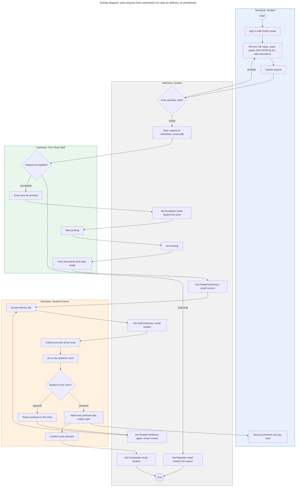

# Diagram 4 – UML Activity: Print request from submission to cash-on-delivery

**Scope:** the core workflow, one swimlane per role (Student, Print Shop Staff, Student Runner) and one for the System.
**Primary audience:** the print shop owner and the team (to agree on who does what, and when).
**Risk it reduces:** handoffs nobody owns, such as who tells the runner a job is ready, or what happens when the student is not in the room.

## Key
| Shape | Meaning |
|---|---|
| Small circle "Start" | Initial node |
| Double circle "End" | Final node |
| Rectangle | Action, placed in the swimlane of whoever does it |
| Diamond | Decision; every outgoing arrow carries a guard in `[brackets]` |
| Coloured box | Swimlane (Student blue, System grey, Print Shop Staff green, Student Runner orange) |

## Notes
- Mermaid cannot force straight lanes, so each coloured box is one lane and the position on the page is chosen automatically.
- Status names in "Set ..." actions match the `RequestStatus` enumeration in Diagram 6 and the states in Diagram 7.
- Student cancellation (Submitted or Accepted only) is a separate flow shown in Diagram 7.
