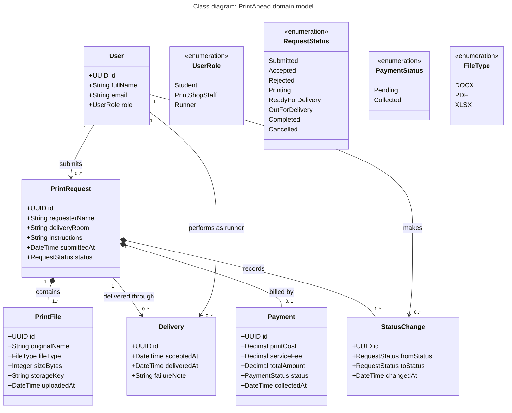

# Diagram 6 – UML Class: PrintAhead domain model

**Scope:** 6 domain classes and 4 enumerations of the MVP.
**Primary audience:** developers and the database designer.
**Risk it reduces:** inconsistent names and rules for the same business concept across code, database, and screens.

## Key
| Notation | Meaning |
|---|---|
| `+Type name` | Public attribute with its type |
| `<<enumeration>>` | Fixed set of allowed values |
| Open arrow | Association (the source knows the target) |
| Filled diamond | Composition: the part cannot exist without the whole |
| Numbers at line ends | Multiplicity (`1`, `0..1`, `0..*`, `1..*`) |

## Notes
- `RequestStatus` values are copied exactly from the states in Diagram 7.
- `PrintRequest` has no Payment until staff sets the price, hence `0..1`.
- A request can have more than one Delivery if the student is absent and the job is re-queued.
- `requesterName` is the full name typed in the form; it can differ from `User.fullName`.
