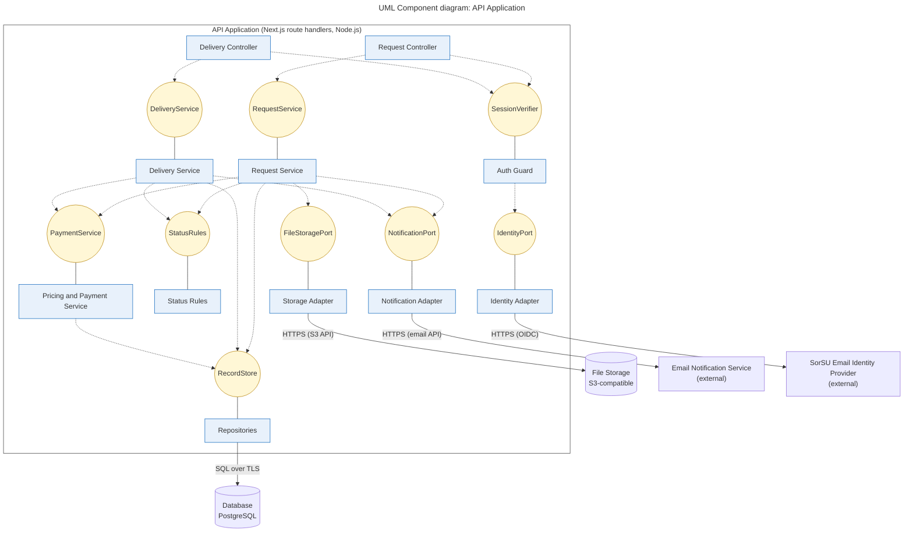

# Diagram 9 – UML Component: API Application internals

**Scope:** the components inside the API container (Diagram 2), their provided and required interfaces, and the external services behind adapters.
**Primary audience:** back-end developers.
**Risk it reduces:** hard-wired external services that cannot be replaced or tested, and business rules scattered across controllers.

## Key
| Notation | Meaning |
|---|---|
| Box inside the large frame | Component |
| Yellow circle | Interface (named contract) |
| Solid line component to circle | The component **provides** that interface |
| Dashed arrow component to circle | The component **requires** that interface |
| Solid arrow to cylinder or external box | Protocol used to reach an outside system |

## Notes
- Every external service (identity provider, file storage, email, database) is reached only through an adapter or repository component.
- `StatusRules` encodes the legal transitions in Diagram 7, so both services share one source of truth.
