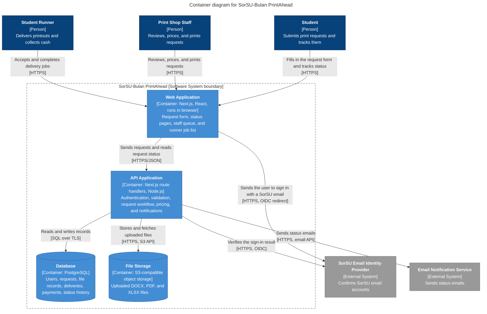

# Diagram 2 – C4 Container: SorSU-Bulan PrintAhead

**Scope:** every deployable or runnable unit inside the system, with its technology.
**Primary audience:** the development team and the instructor.
**Risk it reduces:** unclear technology choices and unclear ownership of data and files.

**Next.js decision (one sentence):** We drew the Next.js app as **two containers**, the Web Application (UI that runs in the user's browser) and the API Application (route handlers that run on the server), because they run in different places even though they ship from one Next.js build.

## Key
| Element | Meaning |
|---|---|
| Container (light blue box) | A separately running unit; the second line is its technology |
| Cylinder | A data store |
| External system (grey box) | A system we depend on but do not build |
| Arrow | Intent of the call, followed by the protocol in brackets |

## Notes
- The technology choices (Next.js, PostgreSQL, S3-compatible storage) are **provisional** until confirmed in your Activity 5 architecture decision.
