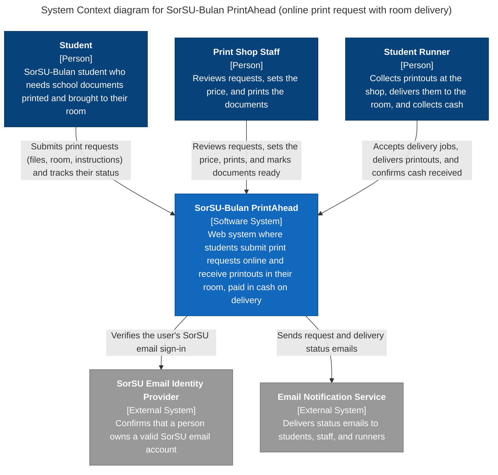

# Diagram 1 – C4 System Context: SorSU-Bulan PrintAhead

**Scope:** the whole system as one box, every user role, and every external system.
**Primary audience:** instructor, print shop owner, and anyone new to the project (non-technical).
**Risk it reduces:** building for the wrong boundary, or forgetting a user role or outside system the MVP depends on.

## Key
| Element | Meaning |
|---|---|
| Person (dark blue box) | A human user role of the system |
| Software system (blue box) | The system we are building (drawn as one box) |
| External system (grey box) | A system we depend on but do not build |
| Arrow | A relationship; the label states what the sender is trying to do |

## Notes
- Payment is **cash on delivery**, so there is no payment provider in this diagram.
- Every actor here appears in the use case diagram (Diagram 3).
- Drawn with a Mermaid flowchart styled to C4 notation (name, element type, description) because Mermaid's native `C4Context` syntax gives poor layout control.
