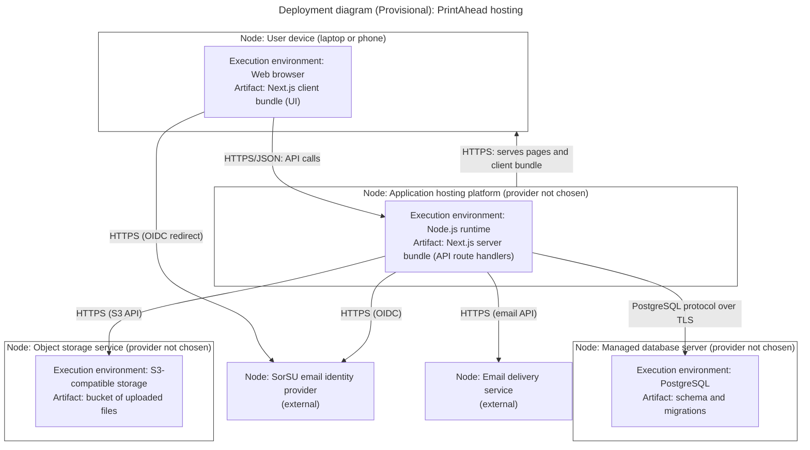

# Diagram 10 – UML Deployment (Provisional): PrintAhead hosting

**Scope:** where each artifact will run. **Provisional:** no hosting provider has been chosen, so node names are generic.
**Primary audience:** the team and the instructor (for the Deployment unit).
**Risk it reduces:** discovering late that something cannot be hosted, or that a connection (such as uploads to storage) was never planned.

## Key
| Notation | Meaning |
|---|---|
| Large frame | Node (a device or server) |
| Box inside a node | Execution environment and the artifact deployed on it |
| Arrow | Communication path, labelled with its protocol |

## Notes
- No secrets, keys, or real addresses are shown. Store them as environment variables on the hosting platform.
