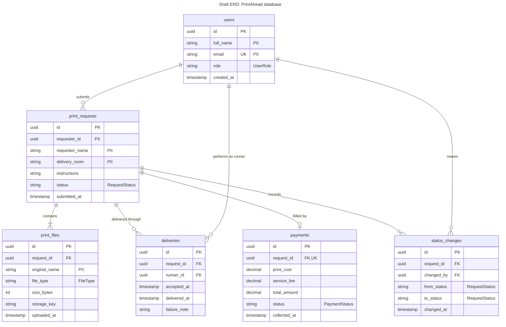

# Diagram 11 – Draft ERD: PrintAhead database

**Scope:** one table per stored class in Diagram 6, with keys, cardinality, and personal data (PII) marked.
**Primary audience:** the database designer, developers, and the data-privacy reviewer.
**Risk it reduces:** missing relationships, and personal data stored or exposed without anyone having decided to.

## Key
| Notation | Meaning |
|---|---|
| PK / FK / UK | Primary key / foreign key / unique key |
| `"PII"` | Column holding personally identifiable information |
| `"RequestStatus"` etc. | Column stores the names from that enumeration in Diagram 6 |
| `\|\|--o{` | Exactly one to zero-or-many (crow's foot) |
| `\|\|--\|{` | Exactly one to one-or-many |
| `\|\|--o\|` | Exactly one to zero-or-one |

## PII notes
- `users.full_name`, `users.email`, `print_requests.requester_name`, `print_requests.delivery_room`, and `print_files.original_name` identify a person or where they are.
- The **contents** of uploaded files may also contain personal data; decide how long files are kept (for example, delete after completion).
