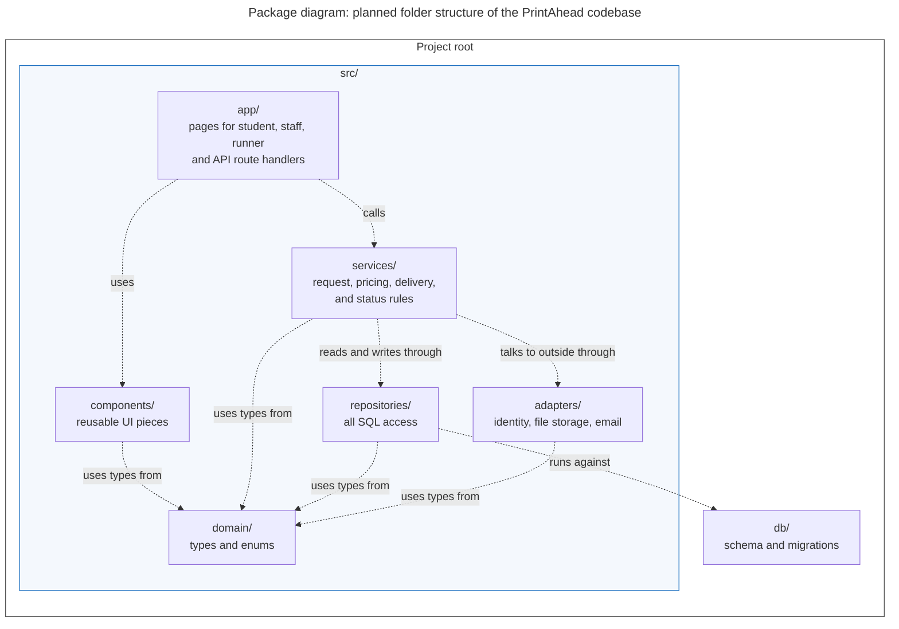

# Diagram 8 – UML Package: Planned folder structure of the PrintAhead codebase

**Scope:** the folders we will create under the project root and the allowed dependencies between them.
**Primary audience:** the developers (and the reviewer of every pull request).
**Risk it reduces:** tangled code, such as pages that run SQL directly or business rules copied into UI components.

**Layering rule:** Pages and components call only services, and only repositories touch the database and only adapters touch external services.

## Key
| Notation | Meaning |
|---|---|
| Box | Package (a folder) with a one-line responsibility |
| Dashed arrow | Dependency: the source folder may import from the target folder |
| No arrow | Importing is not allowed (for example `app/` to `repositories/`) |

## Notes
- Folder names are proposed; adjust them to match what you actually create in the repository.
