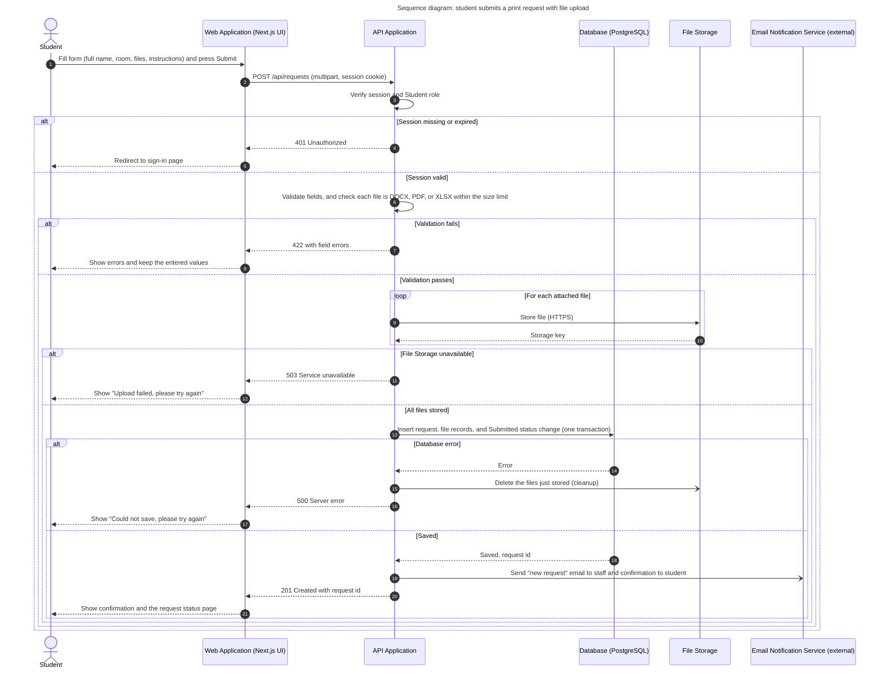

# Diagram 5 – UML Sequence: Student submits a print request with file upload

**Scope:** the riskiest flow, which combines login state, file upload to storage, a database write, and an external email service.
**Primary audience:** the developers building the form, API, and storage code.
**Risk it reduces:** half-saved requests (files stored but no record, or the reverse), and an email failure blocking a valid request.

Sign-in with the SorSU email provider happens **before** this flow; this diagram starts with the student already holding a session.

## Key
| Notation | Meaning |
|---|---|
| Solid arrow with filled head (`->>`) | Synchronous message |
| Dashed arrow (`-->>`) | Reply |
| Open arrowhead (`-)`) | Asynchronous message (no waiting for a reply) |
| `alt` / `else` | Alternative branches; only one runs |
| `loop` | Repeated for each file |

## Notes
- The email is asynchronous: if it fails, the request is still saved.
- `POST /api/requests` is a **proposed** route; align it with your actual repository.
