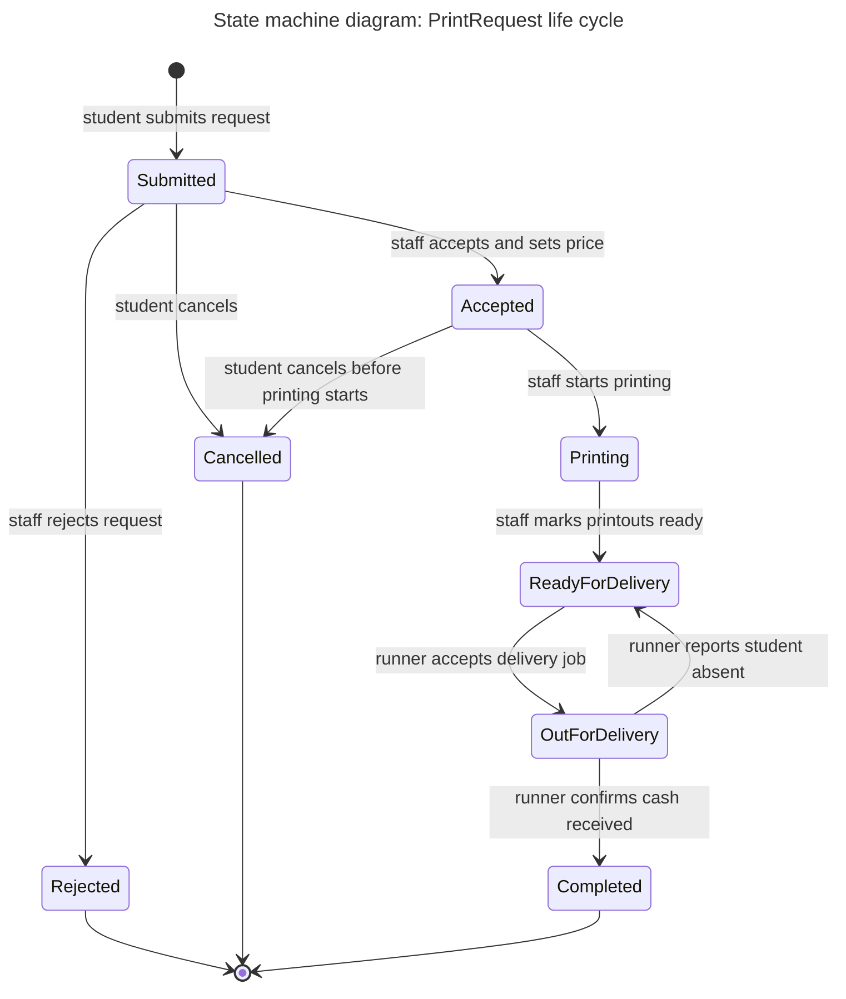

# Diagram 7 – UML State Machine: PrintRequest life cycle

**Scope:** the main entity, `PrintRequest`, from submission to a final state.
**Primary audience:** developers (to enforce legal status changes) and the print shop (to understand each status).
**Risk it reduces:** illegal status jumps, such as delivering a request that was never printed or cancelling after printing has started.

## Key
| Notation | Meaning |
|---|---|
| Filled circle `[*]` (start) | Initial state |
| Circle `[*]` (end) | Final state |
| Rounded box | State, named as a condition the request is in |
| Arrow label | The event that causes the transition |

## State names versus the class diagram
These eight names are identical to the values of the `RequestStatus` enumeration in `class.md`:
`Submitted`, `Accepted`, `Rejected`, `Printing`, `ReadyForDelivery`, `OutForDelivery`, `Completed`, `Cancelled`.
