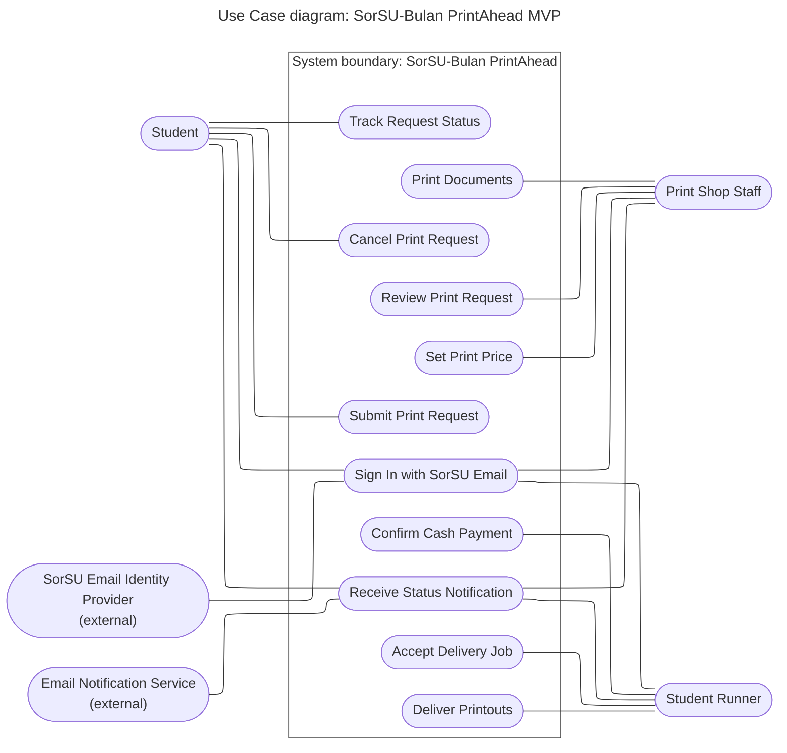

# Diagram 3 – UML Use Case: SorSU-Bulan PrintAhead MVP

**Scope:** the 11 goal-level use cases of the MVP and the five actors from Diagram 1.
**Primary audience:** the instructor, the print shop owner, and the team (to agree on scope).
**Risk it reduces:** building features nobody asked for, or missing a feature a role needs.

## Key
| Shape / line | Meaning |
|---|---|
| Rounded box outside the boundary | Actor (person or external system) |
| Oval inside the boundary | Use case, named verb + object |
| Plain line | Association: the actor takes part in the use case |

## Traceability: MVP feature to use case
| MVP feature (from your description) | Use case |
|---|---|
| Log in with a SorSU email account | Sign In with SorSU Email |
| Request form: full name, room, attached files, instruction message | Submit Print Request |
| See where the request is in the process | Track Request Status |
| Withdraw a request before printing starts | Cancel Print Request |
| Email updates when status changes | Receive Status Notification |
| Shop checks the files and instructions | Review Print Request |
| Shop sets the amount for cash payment | Set Print Price |
| Shop prints and marks the job ready | Print Documents |
| Runner takes a ready job | Accept Delivery Job |
| Runner brings printouts to the room | Deliver Printouts |
| Runner collects cash and closes the job | Confirm Cash Payment |

> Replace this table with your own MVP feature list if it differs. Every row here must match a Must-have feature.
